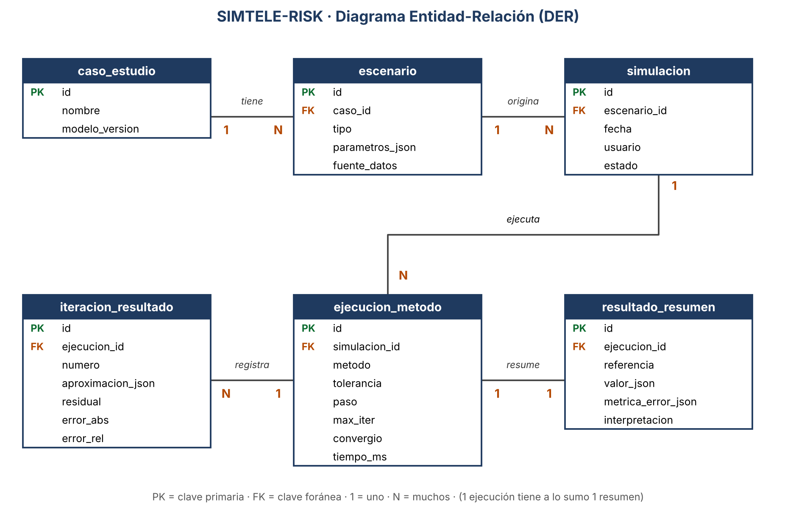
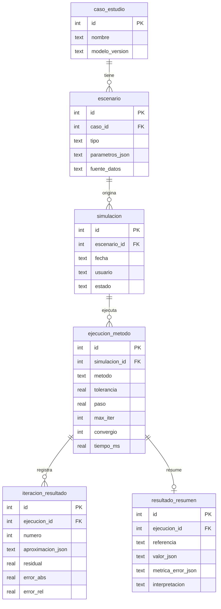

# SIMTELE-RISK · Modelo de datos

Base de datos: **SQLite** (`esquema.sql`). Datos sintéticos, uso educativo.

## Diagrama Entidad-Relación

## Modelo relacional

- **caso_estudio**(<u>id</u>, nombre, modelo_version)
- **escenario**(<u>id</u>, *caso_id*, tipo, parametros_json, fuente_datos)
  - `caso_id` → caso_estudio(id)
  - `tipo` ∈ {NORMAL, ESTRÉS, MAL_CONDICIONADO}
- **simulacion**(<u>id</u>, *escenario_id*, fecha, usuario, estado)
  - `escenario_id` → escenario(id)
- **ejecucion_metodo**(<u>id</u>, *simulacion_id*, metodo, tolerancia, paso, max_iter, convergio, tiempo_ms)
  - `simulacion_id` → simulacion(id)
- **iteracion_resultado**(<u>id</u>, *ejecucion_id*, numero, aproximacion_json, residual, error_abs, error_rel)
  - `ejecucion_id` → ejecucion_metodo(id)
  - UNIQUE(ejecucion_id, numero)
- **resultado_resumen**(<u>id</u>, *ejecucion_id*, referencia, valor_json, metrica_error_json, interpretacion)
  - `ejecucion_id` → ejecucion_metodo(id), UNIQUE (relación 1 a 1)

## Cardinalidades

| Relación | Cardinalidad |
|---|---|
| caso_estudio – escenario | 1 : N |
| escenario – simulacion | 1 : N |
| simulacion – ejecucion_metodo | 1 : N |
| ejecucion_metodo – iteracion_resultado | 1 : N |
| ejecucion_metodo – resultado_resumen | 1 : 1 |

## Persistencia

Los parámetros de entrada se guardan como JSON en `escenario.parametros_json`, lo que permite
**recuperar una simulación y repetir el cálculo** con los mismos datos tras reiniciar la aplicación.
